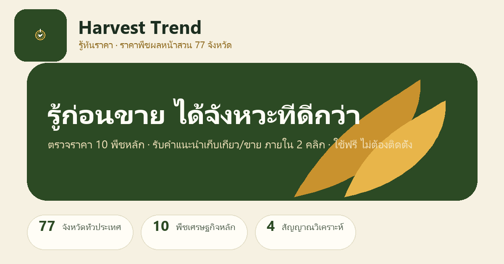

<div align="center">

# 🌾 Harvest Trend · รู้ทันราคา

**เครื่องมือตรวจราคาพืชผลหน้าสวน 77 จังหวัด · 25 พืชหลัก**
**แนะนำจังหวะเก็บเกี่ยว/ขาย ใน 2 แตะ — ใช้ได้แม้ไม่มีเน็ต**

[](https://harvest-ecc.vercel.app)
[](https://harvest-ecc.vercel.app)
[](https://react.dev)
[](https://www.typescriptlang.org)
[](https://vite.dev)
[](https://tailwindcss.com)
[](https://line.me)
[](https://supabase.com)
[](https://github.com/bravforcode/harvest-ecc/actions)



**EEC-SDG Hackathon & Pitching 2026 · Track 5 Smart Agriculture & Food Security**

</div>

---

## ✨ คุณสมบัติ (Features)

| | |
|---|---|
| 🗺️ **77 จังหวัด · 25 พืชหลัก** | ทุเรียน ยางพารา มันสำปะหลัง ข้าว ข้าวโพด อ้อย ปาล์ม เงาะ มังคุด ลำไย หมู ไข่ไก่ ไก่เนื้อ โคเนื้อ กุ้ง ปลานิล นมดิบ กาแฟ มะพร้าว สับปะรด หอมหัวใหญ่ หอมแดง กระเทียม มะม่วง กล้วย |
| ⚡ **2 แตะ ได้คำตอบ** | เลือกจังหวัด → เลือกพืช → อ่านคำแนะนำจังหวะขาย พร้อมเหตุผล ภาษาชาวบ้าน ไม่ต้องมีความรู้เฉพาะทาง |
| 🧠 **ระบบตัดสินใจ 4 สัญญาณ** | ราคา (40%) + อุปทานตามฤดูกาล (25%) + จังหวะเก็บเกี่ยว (20%) + สภาพอากาศ (15%) → ระดับคำแนะนำ 3 ระดับ พร้อมความมั่นใจ |
| 📱 **PWA ใช้ได้ offline** | Service worker แบบ network-first, manifest, ติดตั้งลงหน้าจอได้ ใช้ในแอป LINE/Facebook ได้ |
| 📈 **กราฟราคา 26 สัปดาห์** | ดูแนวโน้มย้อนหลัง + คาดการณ์ 4 สัปดาห์ข้างหน้า |
| 🔔 **แจ้งเตือน Web Push** | ตั้งเกณฑ์ราคาเป้าหมาย ระบบเตือนเมื่อราคาถึงจุดที่ต้องการ (VAPID, cron รายวัน) |
| 💬 **LINE OA Bot** | พิมพ์ถาม เช่น "ราคา ระยอง ทุเรียน" ได้คำตอบทันที + ล็อกอินด้วย LINE เพื่อซิงก์รายการเฝ้าระวัง |
| 📍 **แผนที่ราคา** | Heatmap ราคารายจังหวัด + ดูราคาใกล้เคียง |
| 🧮 **เครื่องคำนวณต้นทุน** | คำนวณต้นทุน/กำไร ช่วยตัดสินใจขาย |
| 📝 **รายงานราคาจากเกษตรกร** | เกษตรกรแชร์ราคาหน้าสวนจริง (ซิงก์ Supabase, ไม่เก็บ GPS) |
| 🌐 **ไทย / อังกฤษ** | สลับภาษาได้ + ปรับขนาดตัวอักษร A− / A+ |
| ♿ **เข้าถึงได้ทุกคน** | Skip-link, focus-visible, aria-live, prefers-reduced-motion, คอนทราสต์ ≥ 4.5:1 |

---

## 🎯 วิธีใช้งาน (How It Works)

```
① เลือกจังหวัด          → ② เลือกพืช          → ③ อ่านคำแนะนำ
   ค้นหา / 6 ภาค / GPS     เน้นพื้นที่ผลิตหลัก      ระดับคำแนะนำ + เหตุผล + ความมั่นใจ
```

**ระดับคำแนะนำ 3 ระดับ:**
- 🟢 **ขายได้เลย** — ราคาดี จังหวะเหมาะสม
- 🟡 **รอได้** — ราคามีแนวโน้มดีขึ้น รออีกนิด
- 🔴 **รีบขาย** — ราคากำลังลง เก็บเกี่ยวแล้วขายทันที

ทุกคำแนะนำมาพร้อม **เหตุผล** จากสัญญาณทั้ง 4 และป้ายแหล่งข้อมูล — **ซื่อสัตย์ต่อข้อมูล**: ข้อมูลจำลองติดป้ายชัดเจน ข้อมูลจริงจากแหล่งรัฐติดป้ายแหล่งที่มา

---

## 🧠 ระบบตัดสินใจ (Verdict Engine)

| สัญญาณ | น้ำหนัก | แหล่งข้อมูล |
|---|---|---|
| 📈 ราคา (Price momentum) | 40% | ราคาหน้าสวนจริงจาก ธปท. (BOT) ผ่าน `/api` |
| 🌾 อุปทานตามฤดูกาล (Seasonal supply) | 25% | ปฏิทินฤดูกาลผลิต 25 พืช |
| ⏰ จังหวะเก็บเกี่ยว (Harvest timing) | 20% | ระยะเวลาเก็บเกี่ยวต่อจังหวัด |
| 🌦️ สภาพอากาศ (Weather) | 15% | แบบจำลองสภาพอากาศรายจังหวัด (ข้อมูลจำลอง) |

> ระบบเป็น **deterministic engine** — โค้ดล้วน ไม่มี AI มั่ว ตรวจสอบได้ทุกขั้นตอน

---

## 🛠️ เทคโนโลยี (Tech Stack)

| ชั้น | เทคโนโลยี |
|---|---|
| **Frontend** | React 19 · TypeScript · Vite 8 · Tailwind CSS 4 · React Router 7 · Leaflet (แผนที่) · Motion |
| **PWA** | vite-plugin-pwa · Workbox · Service Worker (network-first) |
| **Backend** | Vercel Serverless Functions (Node.js) |
| **Database** | Supabase (PostgreSQL + RLS) — ซิงก์ watchlist + รายงานสาธารณะ |
| **LINE** | Messaging API (webhook + flex reply) · LINE Login · Rich Menu |
| **Push** | Web Push API + VAPID · Vercel Cron รายวัน |
| **Fonts** | Sarabun + Noto Sans Thai |

---

## 📁 โครงสร้างโปรเจกต์ (Project Structure)

```
harvest-ecc/
├── src/                    # React app (mobile-first PWA)
│   ├── pages/              # Home · Chart · Map · Cost · Watch · Report · About · LINE
│   ├── components/         # VerdictCard · PriceChart · SeasonCalendar · PushToggle …
│   ├── lib/                # engine.ts (ระบบตัดสินใจ) · data.ts (77 จว. 25 พืช) · i18n · supabase
│   └── sw.ts               # Service Worker
├── api/                    # Vercel Serverless Functions
│   ├── prices.js           # ราคาจริงจาก BOT (ธปท.) + data.go.th
│   ├── line-webhook.js     # LINE OA Bot (flex reply)
│   ├── line-login.js       # LINE Login
│   ├── push.js             # Web Push (VAPID)
│   ├── push-check.js       # Cron รายวัน ตรวจเกณฑ์ราคา
│   └── watch-sync.js       # ซิงก์ watchlist กับ Supabase
├── supabase/               # schema + migrations
├── scripts/                # gen-vapid · set-rich-menu · fetch-costs
├── tests/                  # 449 checks (prices · line-bot · ui-contract)
├── docs/                   # SUPABASE-SETUP · LINE-LOGIN-SETUP · PUSH-SETUP
└── public/                 # icons · og-image · sitemap · robots
```

---

## 🚀 เริ่มต้นใช้งาน (Getting Started)

**ความต้องการ:** Node.js ≥ 18

```bash
# ติดตั้ง dependencies
npm install

# รัน dev server
npm run dev

# build สำหรับ production
npm run build

# รันเทส (449 checks)
npm test
```

---

## 🔐 ตัวแปรสภาพแวดล้อม (Environment Variables)

สร้าง `.env` (ดู `.env.example` — ยังไม่มี ให้สร้างเองตามตาราง):

| ตัวแปร | ใช้ที่ | จำเป็น? |
|---|---|---|
| `VITE_SUPABASE_URL` | Client — ซิงก์ watchlist/รายงาน | ไม่ (local-first) |
| `VITE_SUPABASE_ANON_KEY` | Client | ไม่ |
| `VITE_VAPID_PUBLIC_KEY` | Client — ปุ่มเปิด/ปิดแจ้งเตือน | ไม่ |
| `SUPABASE_URL` | Serverless API | ไม่ |
| `SUPABASE_SERVICE_ROLE_KEY` | Serverless API (ห้ามใส่ฝั่ง client!) | ไม่ |
| `VAPID_PUBLIC_KEY` / `VAPID_PRIVATE_KEY` | `api/push.js` | ไม่ |
| `LINE_CHANNEL_SECRET` | `api/line-webhook.js` | ไม่ |
| `LINE_CHANNEL_ACCESS_TOKEN` | `api/line-webhook.js` | ไม่ |
| `LINE_LOGIN_CHANNEL_ID` / `LINE_LOGIN_CHANNEL_SECRET` | `api/line-login.js` | ไม่ |

> 🔒 **หลักความปลอดภัย:** `SERVICE_ROLE_KEY` และ `VAPID_PRIVATE_KEY` ต้องอยู่ฝั่ง server เท่านั้น — RLS ของ Supabase คือแนวป้องกันหลัก

---

## ☁️ Deploy บน Vercel

```bash
vercel deploy --prod
```

- ตั้ง env vars ผ่าน `vercel env add <NAME> production`
- Cron รายวัน (`/api/push-check`) ตั้งอัตโนมัติผ่าน `vercel.json`
- ตัวอย่างจริง: **https://harvest-ecc.vercel.app**

---

## 🤖 LINE OA Integration

| ความสามารถ | รายละเอียด |
|---|---|
| 💬 **Bot ตอบคำถาม** | "ราคา ระยอง ทุเรียน" → flex reply พร้อมคำแนะนำ |
| 👋 **ข้อความต้อนรับ** | เมื่อมีคน join กลุ่ม |
| 🔑 **LINE Login** | ล็อกอินเพื่อซิงก์ watchlist ข้ามเครื่อง |
| 🎛️ **Rich Menu** | สคริปต์ `scripts/set-rich-menu.mjs` |

คู่มือ: [`docs/LINE-LOGIN-SETUP.md`](docs/LINE-LOGIN-SETUP.md)

---

## 🔔 Web Push Notifications

1. สร้างคู่คีย์ VAPID: `node scripts/gen-vapid.mjs`
2. ตั้ง env: `VITE_VAPID_PUBLIC_KEY` (build-time) + `VAPID_PUBLIC_KEY`/`VAPID_PRIVATE_KEY` (runtime)
3. ผู้ใช้ตั้งเกณฑ์ราคาเป้าหมาย → cron รายวัน (`/api/push-check`) ตรวจ → ส่ง push เมื่อถึงเกณฑ์

คู่มือ: [`docs/PUSH-SETUP.md`](docs/PUSH-SETUP.md)

---

## 🗄️ Supabase

- **Watchlist sync** — ผูกกับ LINE Login `sub` (local-first: ทำงานได้แม้ไม่มี Supabase)
- **รายงานราคาเกษตรกร** — สาธารณะ เก็บที่ Singapore ไม่เก็บ GPS
- Migration: `supabase/migrations/` + `supabase/schema.sql`

คู่มือ: [`docs/SUPABASE-SETUP.md`](docs/SUPABASE-SETUP.md)

---

## 📡 API Endpoints

| Endpoint | หน้าที่ |
|---|---|
| `GET /api/prices?province=&crop=` | ราคาหน้าสวนจริงจาก BOT (ธปท.) + ข้อมูลจำลองที่ติดป้ายชัดเจน |
| `POST /api/line-webhook` | LINE OA webhook — ตอบคำถามราคาแบบ flex |
| `GET /api/line-login` | LINE Login OAuth flow |
| `POST /api/push` | ส่ง Web Push notification |
| `GET /api/push-check` | Cron รายวัน — ตรวจเกณฑ์ราคาและส่ง push |
| `POST /api/watch-sync` | ซิงก์ watchlist กับ Supabase |

---

## 🧪 การทดสอบ (Testing)

```bash
npm test
```

| ชุดเทส | จำนวน | ครอบคลุม |
|---|---|---|
| `tests/prices.test.js` | 35 checks | API ราคา · schema · ความปลอดภัย |
| `tests/line-bot.test.js` | 30 tests | LINE webhook · flex reply · signature |
| `tests/ui-contract.test.js` | 357 checks | 77 จังหวัด · 25 พืช · engine · UI contract |

---

## 📊 แหล่งข้อมูล (Data Sources)

- **ราคาหน้าสวนจริง:** ตาราง ธปท. (BOT) ผ่าน `/api` — อัปเดตอัตโนมัติ
- **data.go.th (CKAN):** ถูกบล็อกจาก IP datacenter ของ Vercel — มี retry + UA rotation (ดู `api/prices.js`)
- **ข้อมูลจำลอง:** ติดป้าย "ข้อมูลจำลอง" เสมอ — **ความซื่อสัตย์ต่อข้อมูลคือข้อกำหนดของผลิตภัณฑ์**
- **ข่าว/บริบท:** doae.go.th · thairath.co.th · thaipbs.or.th · prachachat

> ⚠️ เครื่องมือนี้ให้ข้อมูลเพื่อการตัดสินใจ **ไม่ใช่คำแนะนำทางการเงิน**

---

## ♿ การเข้าถึง (Accessibility & Inclusion)

- ไทย + อังกฤษ · ปรับขนาดตัวอักษร (A− / A+) · skip-link
- focus-visible rings · `aria-live` เมื่อ verdict เปลี่ยน · `prefers-reduced-motion`
- คอนทราสต์ moss/gold บน cream ≥ 4.5:1 · ปุ่มแตะ ≥ 44px · SVG icon (ไม่ใช้อีโมจิแทน)

---

## 🏆 Hackathon

**EEC-SDG Hackathon & Pitching 2026 · Track 5 Smart Agriculture & Food Security**

สอดคล้องกับ SDGs: **1** (ขจัดความยากจน) · **2** (ขจัดความหิวโหย) · **8** (งานที่มีคุณค่า) · **12** (การบริโภคที่ยั่งยืน)

---

## 📄 License

- **โค้ด** (เว็บแอป API และ worker): [Apache License 2.0](LICENSE)
- **เอกสารและชุดข้อมูลรวม** ที่โครงการเผยแพร่: CC BY 4.0
- **แบรนด์** (ชื่อ โลโก้ ไอคอน): สงวนลิขสิทธิ์ทั้งหมด
- **ข้อมูลจากแหล่งภายนอก** (ธปท., data.go.th, สื่อข่าว): อยู่ภายใต้เงื่อนไขการใช้ของแหล่งนั้น โครงการนี้ไม่ได้อนุญาตให้ใช้ซ้ำโดยอัตโนมัติ

Licence for code: Apache-2.0. Docs and aggregated datasets: CC BY 4.0. Brand: all rights reserved. External data (BOT, data.go.th, news) keeps its own terms.

---

<div align="center">

**Harvest Trend · รู้ทันราคา** — *"รู้ก่อนขาย"*

🌾 ตรวจราคา → รู้จังหวะ → ขายได้ราคาดี

</div>